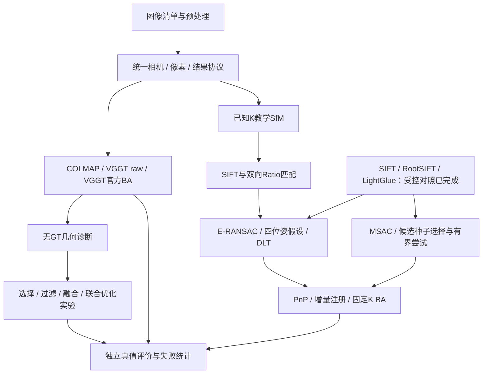
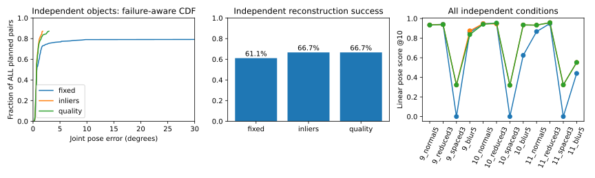

# GeoRecon-Fusion

**Geometry-Reliability-Aware Hybrid Multi-View 3D Reconstruction**

面向三维视觉算法实践的多视图重建项目：统一接入COLMAP与VGGT，实现可解释的已知内参SfM，并研究困难输入下的失败原因及可靠性判断。

**当前结论：** 基线、教学SfM与实验诊断链已实现；稳定融合收益和原创算法优势尚未建立。保留MSAC 1.5 px及内点/几何质量两种排序。五数据来源对照发现AP3P在TUM上的局部收益，但DTU略退化，未通过跨数据集稳定替换门。[最新结果、失败与复现](docs/stage7b_initialization.md#final-five-dataset-search)

## 系统架构与核心实现



| 能力 | 代码入口 | 实现与使用边界 |
|---|---|---|
| 相机、像素、尺度与协议 | [geometry](src/georecon/geometry/)、[data](src/georecon/data/) | world-to-camera、Z-depth、缩放裁剪、DLT、Sim(3)；无畸变PINHOLE |
| 正式基线接入 | [baselines](src/georecon/baselines/) | COLMAP自估内参；VGGT raw；官方跟踪与BA；不包含稠密MVS |
| 双视图SfM | [two_view.py](src/georecon/teaching/two_view.py) | 已知K，SIFT互检、E/H诊断、相对位姿、三角化与拒绝条件 |
| PnP、增量注册、BA | [incremental.py](src/georecon/teaching/incremental.py)、[bundle_adjustment.py](src/georecon/teaching/bundle_adjustment.py) | 已实现；固定种子、固定顺序，小规模教学范围 |
| 候选种子与质量排序 | [initialization.py](src/georecon/teaching/initialization.py) | 复用原增量链；固定/内点/几何质量公平对照；两种排序均保留；未建立跨数据集统一优势 |
| 可靠性与实验策略 | [reliability](src/georecon/reliability/)、[selection](src/georecon/selection/)、[filtering](src/georecon/filtering/)、[fusion](src/georecon/fusion/)、[optimization](src/georecon/optimization/) | 无GT推理信号、unknown、回退、局部融合与优化；没有稳定性能收益 |
| 位姿评价 | [poses.py](src/georecon/evaluation/poses.py) | 覆盖率、旋转/有向平移误差、评价专用Sim(3) ATE；失败不填零误差 |
| 受控学习匹配 | [run_stage7a.py](scripts/run_stage7a.py)、[matching](src/georecon/matching/) | A/B/C共享特征、冻结后端、独立评价；局部收益与新增伤害共存，未通过稳定性门 |

## 真实结果与失败案例

### 基线：DTU小型位姿试验

scan1开发、scan6历史测试，各含normal5、reduced3、spaced3、blur5，共8条件、24次方法运行。四条件相关，只有两个独立物体；后续已反复查看测试结果，不是新盲测或官方完整DTU排名。

| 方法 | 完整输出 / 8 | 开发 / 测试联合AUC@10 | 主要失败与限制 |
|---|---:|---:|---|
| COLMAP | 6/8 | 0.434 / 0.372 | 两个spaced3无重建；模糊条件完整注册但位姿退化 |
| VGGT raw | 8/8 | 0.936 / 0.941 | 相机预测可用不等于特征注册或真实几何正确 |
| VGGT官方BA | 4/8 | 0.449 / 0.439 | 四个五图条件在精细跟踪阶段OOM |

AUC保留失败分母。公共输入800×600，但raw模型网格518×392，BA使用方形预处理；不能将二者差异全部归因于BA。完整角度、ATE、耗时与显存见[基线报告](docs/stage3/report.md)。

### 教学SfM：成功与拒绝都保留


001—003：427条互检匹配、404个接受点；旋转误差1.642°，平移方向误差1.965°。图为原运行保存的匹配预览，最多显示80条：青色为接受点对应，绿色为其余E内点，红色为非E内点；不是全部匹配或GT正确性着色。


001—020：只有4条互检匹配，低于原20条门限，未估计E、未初始化。此图红线表示未被E接受，并不是已由真值判定错误。两图从既有产物原样复制，来源与SHA见[复现说明](docs/reproduction.md#演示资源来源)。

| 已知K地图 | 注册 | BA前→后重投影RMSE | BA前→后重新对齐ATE |
|---|---:|---:|---:|
| reduced3 | 3/3 | 0.352→0.198 px | 1.290→0.244 mm |
| normal5 | 5/5 | 0.419→0.230 px | 2.288→1.214 mm |
| blur5 | 5/5 | 0.547→0.457 px | 1.762→0.929 mm |

这是自实现流程中接入经典BA后的实测改善，不是新算法优于成熟BA。normal5预算耗尽未收敛，尾部误差及固定优化前对齐框架ATE有退化；已知K结果不与自估内参基线作同条件排名。[完整验收及失败](docs/stage6_acceptance/report.md)

### 可靠性与融合：没有稳定收益

| 方法 | 开发F1@2mm | 历史测试F1@2mm |
|---|---:|---:|
| raw / 场景选择 | 18.312% | 15.680% |
| 点过滤 | 17.082% | 15.710% |
| 加权融合 | 18.354% | 15.684% |
| 联合优化 | 18.336% | 15.680% |

此为有限采样、自定义点云评价，不是官方DTU稠密排名。融合只改502点（约0.0077%）；其余六条件回退。选择全部选raw、未知点误删、权重优势不迁移及留出源视图混杂均有保留。暂不扩大该融合路线。[消融与负结果](docs/stage5_acceptance/report.md) · [502点诊断](docs/fusion_diagnostics_502/report.md) · [留出验证](docs/heldout_fusion_502/report.md)

### Stage 7A：学习匹配有局部收益，稳定性门未通过

A为原SIFT互检，B为共享RootSIFT互检，C为同一RootSIFT＋官方LightGlue；已知K、46个去重图像对、三个固定几何种子，按四条件宏平均。scan6为已反复查看的历史验证，两个物体不足以证明泛化，数值不与上面的自估内参基线直接排名。

| 物体 | A AUC@10 | B AUC@10 | C AUC@10 | C−B |
|---|---:|---:|---:|---:|
| scan1 | 0.6068 | 0.5429 | 0.6027 | +0.0597 |
| scan6 | 0.2627 | 0.4760 | 0.5722 | +0.0962 |

C相对B救回7个模糊对的正确位姿，但2个普通对退化、6个不同图像对新增错误接受，冻结G2失败；scan1相对旧A的AUC也略降。困难对的GT极线兼容候选数配对差中位数为+66/+101，这是几何代理，不是真实3D对应精度。整批含预热与冷启动耗时32.40s，整卡采样峰值2065MiB；首轮软件失败及全部反例仍保留。[结果、继续门与失败案例](docs/stage7a_results.md) · [逐组表](docs/results/stage7a_pairs.csv) · [逐条件表](docs/results/stage7a_conditions.csv)

### Stage 7B：简单种子选择有收益，质量评分未通过

固定 LightGlue 前端、已知K、MSAC 1.5 px；新增scan9/10/11各四条件、三个种子。36次运行只有3个独立物体，未注册对保留在分母。

| 新物体指标 | 固定种子 | 内点排序 | 几何质量排序 |
|---|---:|---:|---:|
| 正确初始化 | 69.4% | 100% | 100% |
| 完整准确重建 | 61.1% | 66.7% | 66.7% |
| 线性位姿分数@10 | .6259 | .7485 | .7453 |
| 错误 / 严重配对位置 | 16 / 10 | 0 / 0 | 0 / 0 |

位姿分数沿用 `mean(max(0,1-error/10))`，完整准确重建要求全部相机注册且全部相对位姿≤5°。评分增幅主要包含宽视角从空图恢复到两相机部分图，不能都算完整场景恢复。旧scan6宽视角在两种候选方案中新增严重错误，质量评分在scan9退化；没有建立跨条件稳定无伤害替换或原创算法优势。自估K的COLMAP仅作为不同条件的参考。[完整报告、消融与复现](docs/stage7b_initialization.md) · [精简指标](docs/results/stage7b_initialization.csv)



前轮跨数据集复核另含Strecha四序列、Middlebury两个物体，共720次冻结运行。LightGlue下，内点/质量排序@10分别为Strecha .9076/.9074、Middlebury .2962/.2828；Middlebury准确完整率27.5%/25%。当轮优先保留[内点排序候选](configs/teaching/initialization_selection.json)，质量排序及全部负结果继续保留。两种排序相对固定种子均出现新增严重错误；此选择不代表稳定安全的生产默认值。[完整外部验证](docs/stage7b_initialization.md#2026-10-18跨数据集稳定性复核与保留决定) · [逐场景差异](docs/results/stage7b_cross_dataset_scenes.csv)

### 最后一轮：五数据来源，保留AP3P候选及退化

DTU、Strecha、Middlebury、TUM RGB-D、South Building共12个外部场景、四条件、五种子；5,760次对照不是5,760个独立样本。固定匹配/MSAC/BA，只替换PnP求解器；South Building使用SfM样例参考位姿，不是独立真值。

| LightGlue＋内点排序 | 原EPnP→AP3P位姿分数@10 | 错误接受 | 严重错误 |
|---|---:|---:|---:|
| DTU | .7482→.7458 | 0→0 | 0→0 |
| Strecha | .9076→.9086 | 23→20 | 19→16 |
| Middlebury | .2962→.2973 | 51→49 | 23→22 |
| TUM RGB-D | **.2880→.3175** | **56→45** | 8→8 |
| South Building* | .7256→.7278 | 5→5 | 5→5 |

TUM分数增加2.94个百分点、错误接受减少19.6%；两段序列与五种子的宏平均均改善，仍有单条件注册3→2的失败。质量排序上AP3P也改善TUM（.3339→.3590，错误46→36），但质量排序在DTU/Middlebury落后，故两排序都保留。**完整准确重建率未提高；AP3P是探索性候选，尚未独立确认，不自动改默认。** 开发预选LM因新增严重错误未通过。标准AP3P/LM来自OpenCV，不是原创求解器。[全部对照及反例](docs/stage7b_initialization.md#final-five-dataset-search) · [汇总CSV](docs/results/stage7b_final_search.csv) · [AP3P全部240项变化](docs/results/stage7b_final_ap3p_pairs.csv) · [实验组件](src/georecon/teaching/pnp_refinement.py)

## Quick Start：完整CPU协议与评价示例

从仓库根目录，在Python 3.12环境执行；无需DTU、模型或GPU：

```bash
python3.12 -m venv .venv
source .venv/bin/activate
python -m pip install -e .
georecon synthetic-demo --config configs/experiments/stage1_synthetic.json --output outputs/quickstart
georecon inspect-scene outputs/quickstart/manifest.json
georecon evaluate-poses --prediction outputs/quickstart/prediction_exact_sim3.json --reference outputs/quickstart/reference.json --output outputs/quickstart/rechecked.json
```

该示例生成图像与相机fixture，完成加载、结果协议和评价；**不从图像估计相机，不是重建性能演示。** 预期生成完整、部分注册、完全失败三组结果，exact_sim3对齐误差接近浮点零；已有manifest的目录拒绝覆盖，重跑请改输出目录。

[安装矩阵、真实SfM命令与复现边界](docs/reproduction.md)说明如何运行已有数据上的双视图、PnP/增量和BA，以及哪些基线需要额外源码/权重。

### CPU测试与CI

```bash
python -m pip install -e '.[teaching,optimization,colmap]'
python -m pip check
python -m unittest discover -s tests -v
```

[CPU CI](.github/workflows/cpu-tests.yml)在Python 3.12安装上述依赖，运行全部发现的单元测试，逐项输出跳过原因，并将通过、跳过、失败与错误写入Actions摘要。默认不安装Torch/LightGlue、不下载权重、不运行GPU模型。本轮本地主环境240项中239通过、1项原生PyCOLMAP测试跳过；独立COLMAP环境另跑适配器10项全部通过，包含原生测试。尚未提交本轮代码，不能将本地结果写成GitHub CI成功；实际CI日志为准。

## 贡献归属与限制

- **本项目实现：** 协议/适配与评价、经典教学几何链、实验策略、消融与失败诊断。教学实现使用成熟算法和求解器，不作为新SfM算法。
- **第三方：** COLMAP/PyCOLMAP、VGGT及官方跟踪/BA、LightGlue预训练模型、OpenCV估计器、SciPy优化器。来源和权重条款见[复现与归属说明](docs/reproduction.md#第三方归属与数据)。未为第三方重新许可，也未选定项目许可证。
- 历史研究只有两个反复查看的物体；Stage 7B新增三个DTU物体及Strecha四序列、Middlebury两个物体，仍不足以证明广泛泛化，新数据已用于候选验证与保留决定。没有稠密MVS、生产级SfM或稳定融合收益证据。低残差、更多匹配、完整输出都不等于准确率。
- SIFT＋LightGlue已完成受控验证，支持有限样本上的局部准确性改善；scan1宽间隔001–020的28条候选仍被E内点门拒绝，scan6宽间隔010–020新增约63°错误接受。未建立稳定无伤害提升或算法新颖性。
- 原始数据、权重、vendor和大产物不入Git；部分历史重放依赖本地缓存及本机环境，不能仅clone仓库就完整复现实验。GPU使用上限12GB，五图官方BA的OOM仍保留。

## 技术文档与历史证据

| 主题 | 入口 |
|---|---|
| 当前安装、运行与历史复现分层 | [reproduction.md](docs/reproduction.md) |
| 相机/像素/尺度/状态协议 | [protocol.md](docs/protocol.md) |
| 双视图数学与中间产物 | [walkthrough](docs/stage6/walkthrough.md) |
| 基线适配与官方BA | [COLMAP](docs/stage2_colmap/report.md) · [VGGT raw](docs/stage2_vggt/report.md) · [官方BA](docs/stage2_vggt_ba/report.md) |
| 无GT几何诊断与反例 | [可靠性报告](docs/stage4/report.md) |
| 选择/融合与消融验收 | [阶段5验收](docs/stage5_acceptance/report.md) |
| PnP、增量与教学BA | [增量注册](docs/stage6_incremental/report.md) · [BA](docs/stage6_ba/report.md) · [阶段6验收](docs/stage6_acceptance/report.md) |
| Stage 7A受控结果与反例 | [结果与复现边界](docs/stage7a_results.md) · [冻结协议](docs/stage7a_protocol.md) |
| Stage 7B种子选择、独立测试与负结果 | [技术报告与复现](docs/stage7b_initialization.md) · [实现](src/georecon/teaching/initialization.py) |
| 学习匹配器预检 | [预检报告](docs/sift_lightglue_preflight/report.md) |
| 累计贡献边界与项目约定 | [contributions](docs/contributions.md) · [AGENTS](AGENTS.md) · [原项目要求](docs/project_brief.md) |

历史报告保留各次执行时的范围与计数，当前能力以本页和源码为准；本轮未删除、归档或改写历史实验。
