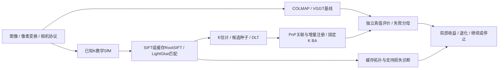

# GeoRecon-Fusion

**多视图稀疏重建、受控评测与失败诊断** · Python / NumPy / OpenCV / SciPy / PyTorch

从图像、相机约定到可评价的稀疏地图，本项目统一接入COLMAP与VGGT，并实现已知内参的教学SfM/BA，分析困难输入下匹配、初始化和注册为何失败。

**已有价值是完整几何工程与可核验的局部收益；尚未证明稳定融合收益、跨数据集稳定优势或原创求解器。** 项目名称保留原研究目标，当前不把融合路线作为已成功的方法推广。

[核心实现与贡献归属](docs/contributions.md#portfolio-contributions) · [安装与完整复现](docs/reproduction.md) · [全部技术报告、指标与失败证据](docs/README.md)

## 系统架构与核心实现



| 项目侧实现 | 代码入口 | 与第三方的边界 |
|---|---|---|
| 相机、像素、尺度与独立评价 | [geometry](src/georecon/geometry/)、[poses.py](src/georecon/evaluation/poses.py) | world-to-camera、K变换、Sim(3)评价；失败不填零误差 |
| 双视图相对位姿、DLT与拒绝条件 | [two_view.py](src/georecon/teaching/two_view.py) | 组织E的四位姿假设、正深度/视差/重投影门；特征与E/H估计使用OpenCV |
| 2D–3D身份关联、增量注册与BA问题构建 | [incremental.py](src/georecon/teaching/incremental.py)、[bundle_adjustment.py](src/georecon/teaching/bundle_adjustment.py) | 项目管理观测、规范约束与稀疏残差；PnP由OpenCV、最小二乘由SciPy求解 |
| 种子选择、可插拔PnP与支持诊断 | [initialization.py](src/georecon/teaching/initialization.py)、[PnP组件](src/georecon/teaching/pnp_refinement.py)、[support_diagnostic.py](src/georecon/evaluation/support_diagnostic.py) | 共享输入与冻结后端对照；AP3P/两排序显式可选，不按GT择优或升级默认 |
| 基线与学习匹配适配 | [baselines](src/georecon/baselines/)、[matching](src/georecon/matching/) | 集成COLMAP、VGGT与LightGlue已有能力，未自训网络或原创其求解器 |

## 真实结果与失败案例

<a id="evidence-overview"></a>

| 已有验证 | 真实收益或结果 | 同时保留的限制与反例 |
|---|---|---|
| 已知K教学BA，DTU单物体reduced3 | 重投影RMSE **0.352→0.198px**；重新对齐ATE **1.290→0.244mm** | 是经典BA的局部效果；normal5预算未收敛，尾部及固定原对齐ATE有退化。[验收](docs/stage6_acceptance/report.md) |
| AP3P留出确认，LightGlue＋质量排序 | 新DTU线性位姿分数@10 **.6303→.6492**；完整准确图 **28/60→30/60**，错误保持0 | 净增两次来自同物体同条件的两个种子；另两物体略降、TUM收益未复制；内点排序新增4个错误。**稳定门未通过。** [报告](docs/stage7c_confirmation.md#stage7c-acceptance) · [CSV](docs/results/stage7c_confirmation_contrasts.csv) |
| 可靠性与融合 | 加权融合历史测试F1@2mm **15.680%→15.684%** | 极小且不稳定，不作为有效突破；误删、回退和源视图混杂均保留。当前融合与轨迹修复路线停止。[融合验收](docs/stage5_acceptance/report.md) · [支持诊断](docs/stage7d_support_diagnostic.md) |

完整准确图要求全部相机注册且全部相对位姿误差≤5°；分数@10是线性截断位姿分数，不是标准AUC或点云精度。条件与种子相关，不能当独立场景数；已知K与自估K基线不能直接排名。

| 真实成功案例：scan1 001–003 | 真实拒绝案例：scan1 001–020 |
|---|---|
|  |  |
| 427条互检匹配、404个接受点；旋转/平移方向误差1.642°/1.965° | 仅4条互检匹配，低于原20条门；未估计E、未初始化 |

预览最多显示80条匹配：青色为接受点对应，绿色为其余E内点，红色为非E内点；拒绝案例的红线不是GT判错。它们是历史匹配图，不是三维点云或Baseline/Improved/GT渲染。[原图来源与SHA](docs/reproduction.md#演示资源来源)

学习匹配新增错误接受、官方VGGT BA五图OOM、部分地图及不可评估案例均在[文档索引](docs/README.md)中保留，未通过删失败制造提升。

## Quick Start：完整CPU协议与评价示例

从仓库根目录，在Linux/WSL、Python 3.12环境中执行；无需DTU、模型或GPU：

```bash
python3.12 -m venv .venv
source .venv/bin/activate
python -m pip install -e .
georecon synthetic-demo --config configs/experiments/stage1_synthetic.json --output outputs/quickstart
georecon inspect-scene outputs/quickstart/manifest.json
georecon evaluate-poses --prediction outputs/quickstart/prediction_exact_sim3.json --reference outputs/quickstart/reference.json --output outputs/quickstart/rechecked.json
```

该例生成数学fixture并跑通数据、结果协议与评价，**不从图像估计相机，不是重建性能演示**。完整、部分注册、无重建三种状态均有输出；exact_sim3对齐误差接近浮点零。请使用全新的输出目录与文件，保留旧结果。

真实双视图、增量SfM、BA和模型入口，以及数据/权重/缓存条件见[复现说明](docs/reproduction.md)。真实实验不能仅靠clone离线完整重放；历史验收还可能要求对应源码版本。

### CPU测试与CI

```bash
python -m pip install -e '.[teaching,optimization,colmap]'
python -m pip check
python -m unittest discover -s tests -v
```

[CPU CI](.github/workflows/cpu-tests.yml)不下载模型或运行GPU推理。[已合并main的CI](https://github.com/zchming/GeoRecon-Fusion-Geometry-Reliability-Aware-Hybrid-Multi-View-3D-Reconstruction/actions/runs/39130662066)报告252项：**246通过、6项需独立LightGlue环境而跳过、0失败/错误**。跳过不算通过，CPU测试通过也不等于完整实验可复现。[依赖与跳过说明](docs/reproduction.md#cpu-ci与跳过解释)

## 贡献归属与限制

- **项目侧实现：** 几何协议、DLT、观测关联与注册调度、BA问题构建、适配器、受控评测和失败诊断；不是新的PnP/BA求解器。
- **第三方：** COLMAP/PyCOLMAP、VGGT及官方跟踪/BA、LightGlue权重、OpenCV估计器、SciPy优化器；源码和数据来源见[归属说明](docs/reproduction.md#第三方归属与数据)。未替第三方重新许可，未选定项目许可证。
- 小样本、已反复查看的数据、相关条件/种子与有限BA预算限制结论；没有稠密MVS、生产级SfM、稳定融合收益或算法新颖性证明。

完整方法、指标、协议、OOM及负结果通过[文档索引](docs/README.md)追溯；[个人贡献与简历表述](docs/contributions.md#portfolio-contributions)应与实际承担、能解释和能复现的工作一致。
