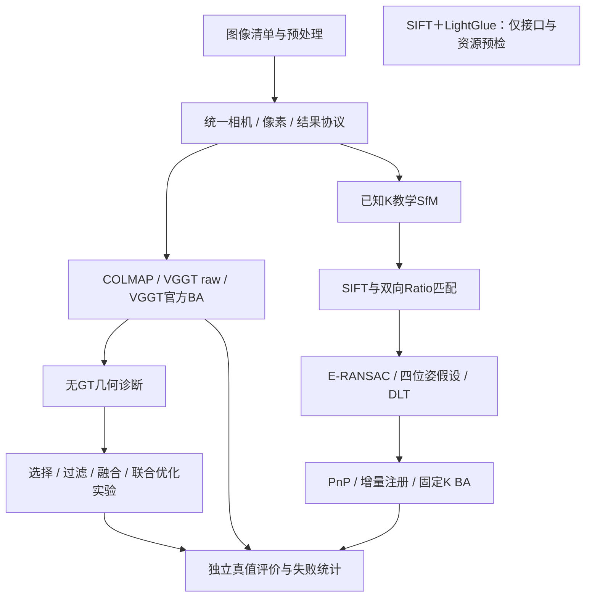
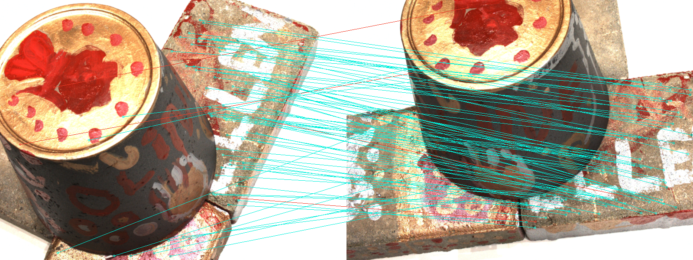
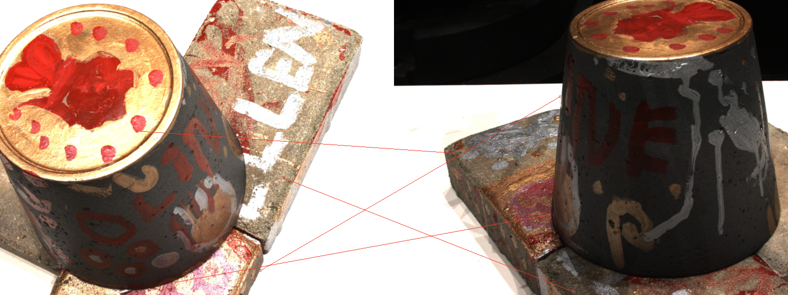

# GeoRecon-Fusion

**Geometry-Reliability-Aware Hybrid Multi-View 3D Reconstruction**

面向三维视觉算法实践的多视图重建项目：统一接入COLMAP与VGGT，实现可解释的已知内参SfM，并研究困难输入下的失败原因及可靠性判断。

**当前结论：** 基线、教学SfM与实验诊断链已实现；稳定融合收益、原创算法优势和未知场景泛化尚未建立。SIFT＋LightGlue仅完成兼容性预检，下一步候选为学习匹配与鲁棒初始化，Stage 7A尚未启动。

## 系统架构与核心实现



| 能力 | 代码入口 | 实现与使用边界 |
|---|---|---|
| 相机、像素、尺度与协议 | [geometry](src/georecon/geometry/)、[data](src/georecon/data/) | world-to-camera、Z-depth、缩放裁剪、DLT、Sim(3)；无畸变PINHOLE |
| 正式基线接入 | [baselines](src/georecon/baselines/) | COLMAP自估内参；VGGT raw；官方跟踪与BA；不包含稠密MVS |
| 双视图SfM | [two_view.py](src/georecon/teaching/two_view.py) | 已知K，SIFT互检、E/H诊断、相对位姿、三角化与拒绝条件 |
| PnP、增量注册、BA | [incremental.py](src/georecon/teaching/incremental.py)、[bundle_adjustment.py](src/georecon/teaching/bundle_adjustment.py) | 已实现；固定种子、固定顺序，小规模教学范围 |
| 可靠性与实验策略 | [reliability](src/georecon/reliability/)、[selection](src/georecon/selection/)、[filtering](src/georecon/filtering/)、[fusion](src/georecon/fusion/)、[optimization](src/georecon/optimization/) | 无GT推理信号、unknown、回退、局部融合与优化；没有稳定性能收益 |
| 位姿评价 | [poses.py](src/georecon/evaluation/poses.py) | 覆盖率、旋转/有向平移误差、评价专用Sim(3) ATE；失败不填零误差 |
| 学习匹配候选 | [preflight_sift_lightglue.py](scripts/preflight_sift_lightglue.py) | 官方权重及坐标/RootSIFT契约预检；尚未验证几何或位姿收益 |

## 真实结果与失败案例

### 基线：DTU小型位姿试验

scan1开发、scan6历史测试，各含normal5、reduced3、spaced3、blur5，共8条件、24次方法运行。四条件相关，只有两个独立物体；后续已反复查看测试结果，不是新盲测或官方完整DTU排名。

| 方法 | 完整输出 / 8 | 开发 / 测试联合AUC@10 | 主要失败与限制 |
|---|---:|---:|---|
| COLMAP | 6/8 | 0.434 / 0.372 | 两个spaced3无重建；模糊条件完整注册但位姿退化 |
| VGGT raw | 8/8 | 0.936 / 0.941 | 相机预测可用不等于特征注册或真实几何正确 |
| VGGT官方BA | 4/8 | 0.449 / 0.439 | 四个五图条件在精细跟踪阶段OOM |

AUC保留失败分母。公共输入800×600，但raw模型网格518×392，BA使用方形预处理；不能将二者差异全部归因于BA。完整角度、ATE、耗时与显存见[基线报告](docs/stage3/report.md)。

### 教学SfM：成功与拒绝都保留



001—003：427条互检匹配、404个接受点；旋转误差1.642°，平移方向误差1.965°。图为原运行保存的匹配预览，最多显示80条：青色为接受点对应，绿色为其余E内点，红色为非E内点；不是全部匹配或GT正确性着色。



001—020：只有4条互检匹配，低于原20条门限，未估计E、未初始化。此图红线表示未被E接受，并不是已由真值判定错误。两图从既有产物原样复制，来源与SHA见[复现说明](docs/reproduction.md#演示资源来源)。

| 已知K地图 | 注册 | BA前→后重投影RMSE | BA前→后重新对齐ATE |
|---|---:|---:|---:|
| reduced3 | 3/3 | 0.352→0.198 px | 1.290→0.244 mm |
| normal5 | 5/5 | 0.419→0.230 px | 2.288→1.214 mm |
| blur5 | 5/5 | 0.547→0.457 px | 1.762→0.929 mm |

这是自实现流程中接入经典BA后的实测改善，不是新算法优于成熟BA。normal5预算耗尽未收敛，尾部误差及固定优化前对齐框架ATE有退化；已知K结果不与自估内参基线作同条件排名。[完整验收及失败](docs/stage6_acceptance/report.md)

### 可靠性与融合：没有稳定收益

| 方法 | 开发F1@2mm | 历史测试F1@2mm |
|---|---:|---:|
| raw / 场景选择 | 18.312% | 15.680% |
| 点过滤 | 17.082% | 15.710% |
| 加权融合 | 18.354% | 15.684% |
| 联合优化 | 18.336% | 15.680% |

此为有限采样、自定义点云评价，不是官方DTU稠密排名。融合只改502点（约0.0077%）；其余六条件回退。选择全部选raw、未知点误删、权重优势不迁移及留出源视图混杂均有保留。暂不扩大该融合路线。[消融与负结果](docs/stage5_acceptance/report.md) · [502点诊断](docs/fusion_diagnostics_502/report.md) · [留出验证](docs/heldout_fusion_502/report.md)

## Quick Start：完整CPU协议与评价示例

从仓库根目录，在Python 3.12环境执行；无需DTU、模型或GPU：

```bash
python3.12 -m venv .venv
source .venv/bin/activate
python -m pip install -e .
georecon synthetic-demo --config configs/experiments/stage1_synthetic.json --output outputs/quickstart
georecon inspect-scene outputs/quickstart/manifest.json
georecon evaluate-poses --prediction outputs/quickstart/prediction_exact_sim3.json --reference outputs/quickstart/reference.json --output outputs/quickstart/rechecked.json
```

该示例生成图像与相机fixture，完成加载、结果协议和评价；**不从图像估计相机，不是重建性能演示。** 预期生成完整、部分注册、完全失败三组结果，exact_sim3对齐误差接近浮点零；已有manifest的目录拒绝覆盖，重跑请改输出目录。

[安装矩阵、真实SfM命令与复现边界](docs/reproduction.md)说明如何运行已有数据上的双视图、PnP/增量和BA，以及哪些基线需要额外源码/权重。

### CPU测试与CI

```bash
python -m pip install -e '.[teaching,optimization,colmap]'
python -m pip check
python -m unittest discover -s tests -v
```

[CPU CI](.github/workflows/cpu-tests.yml)在Python 3.12安装上述依赖，运行全部发现的单元测试，逐项输出跳过原因，并将通过、跳过、失败与错误写入Actions摘要。默认不安装Torch/LightGlue、不下载权重、不运行GPU模型。目前152项中，完整CPU依赖下147项通过，5项LightGlue契约测试因可选依赖缺失跳过；测试数会随实现变化，实际运行日志为准。

## 贡献归属与限制

- **本项目实现：** 协议/适配与评价、经典教学几何链、实验策略、消融与失败诊断。教学实现使用成熟算法和求解器，不作为新SfM算法。
- **第三方：** COLMAP/PyCOLMAP、VGGT及官方跟踪/BA、LightGlue预训练模型、OpenCV估计器、SciPy优化器。来源和权重条款见[复现与归属说明](docs/reproduction.md#第三方归属与数据)。未为第三方重新许可，也未选定项目许可证。
- 只有两个反复查看的物体；没有独立新场景、稠密MVS、生产级SfM或稳定融合收益证据。低残差、更多匹配、完整输出都不等于准确率。
- SIFT＋LightGlue预检输出28条宽间隔候选，未几何验证。该候选与后续Stage 7A均不属于已完成性能贡献。
- 原始数据、权重、vendor和大产物不入Git；部分历史重放依赖本地缓存及本机环境，不能仅clone仓库就完整复现实验。GPU使用上限12GB，五图官方BA的OOM仍保留。

## 技术文档与历史证据

| 主题 | 入口 |
|---|---|
| 当前安装、运行与历史复现分层 | [reproduction.md](docs/reproduction.md) |
| 相机/像素/尺度/状态协议 | [protocol.md](docs/protocol.md) |
| 双视图数学与中间产物 | [walkthrough](docs/stage6/walkthrough.md) |
| 基线适配与官方BA | [COLMAP](docs/stage2_colmap/report.md) · [VGGT raw](docs/stage2_vggt/report.md) · [官方BA](docs/stage2_vggt_ba/report.md) |
| 无GT几何诊断与反例 | [可靠性报告](docs/stage4/report.md) |
| 选择/融合与消融验收 | [阶段5验收](docs/stage5_acceptance/report.md) |
| PnP、增量与教学BA | [增量注册](docs/stage6_incremental/report.md) · [BA](docs/stage6_ba/report.md) · [阶段6验收](docs/stage6_acceptance/report.md) |
| 学习匹配器预检 | [预检报告](docs/sift_lightglue_preflight/report.md) |
| 累计贡献边界与项目约定 | [contributions](docs/contributions.md) · [AGENTS](AGENTS.md) · [原项目要求](docs/project_brief.md) |

历史报告保留各次执行时的范围与计数，当前能力以本页和源码为准；本轮未删除、归档或改写历史实验。
