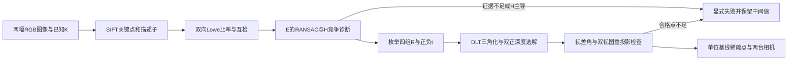

# 双视图 SfM 教学链路与中间产物

本模块需要两张无畸变图像及各自已知的 K；不估计内参，不使用真实 R/t 或真实尺度。它展示双视图几何，不是完整增量 SfM。



## 1. 像素与已知内参

OpenCV SIFT 的像素坐标按零基像素中心使用；这里没有 COLMAP 的原生角点坐标转换，不额外减0.5。DTU 本地原图为1600×1200，按既有Pillow BILINEAR处理为800×600，像素中心仿射为：

```text
u_new = sx*(u_old+0.5)-0.5
v_new = sy*(v_old+0.5)-0.5
A = [[sx, 0, (sx-1)/2], [0, sy, (sy-1)/2], [0,0,1]]
K_new = A @ K_old
x_normalized = inverse(K_new) @ [u_new, v_new, 1]
```

完整K求逆会处理斜切项，K1/K2不必相同。输入提供的K来自标定是本阶段明确假设，不属于“无标定重建”。准备脚本可以读取标定/真值文件以分离已知K输入和评价参考；运行进程只能读入已拆分的K、图像或观测，不读取真实位姿/尺度。

## 2. 特征与匹配

每幅图独立提取SIFT。对描述子做L2最近两邻居，要求 `distance1 < 0.75*distance2`，再要求另一方向也选择回同一特征。特征上限4096是OpenCV的nfeatures目标，并非对并列响应数作额外静默裁剪；记录实际关键点数。

`features_matches.npz`：两幅关键点、互检特征索引、两端像素、最近两邻居距离。可按 `match_indices` 回到原关键点；互检减少歧义，但不保证匹配正确。

## 3. 鲁棒几何与退化提示

归一化坐标满足 `x2.T @ E @ x1 = 0`。OpenCV五点法/RANSAC估计E，像素门限1.5按两幅图fx/fy均值转换为归一化门限；不同焦距下这是单一近似阈值，最终点还要过实际像素重投影检查。

本实现需要至少20对互检匹配和20个E内点，这是工程保守门限，不是说五点法数学上需要20点。另拟合H；若H解释至少90%匹配且内点数至少为E的95%，拒绝为“单应性主导、几何有歧义”。它不能证明一定是平面或纯旋转，可能拒绝某些实际可解场景；本模块不继续做H分解。

`geometry_steps.npz` 保存E、H及对应掩码。匹配不足时没有E，不填造矩阵或点云。

## 4. 位姿四解与三角化

E分解得到两种旋转和正负平移方向：`(R1,+t),(R1,-t),(R2,+t),(R2,-t)`。约定：

```text
camera1: X_c1 = I @ X + 0
camera2: X_c2 = R @ X + t
camera2 world center: C2 = -R.T @ t    # 注意：C2不是t
norm(t) = 1
```

对每个E内点建立4×4齐次DLT方程，SVD最小右奇异向量给出齐次X，再除以最后一维。每个候选计算第一与第二相机Z，选择有限且双正深度最多的候选；平分按较小双视图最大重投影中位数。没有从GT中选姿态。

`steps.json` 列出四个候选的双正深度点数；`geometry_steps.npz` 的 `candidate_xyz/depths/parallax_deg/reprojection_px` 是所选候选的全部E内点诊断，包含被拒绝值；`essential_match_indices` 将它们映射回互检匹配。

## 5. 点质量与尺度

保留点要求：双正深度、视差角至少0.5°、两个视图重投影误差均不超过2像素；至少20个合格点。视差角来自 `X-C1` 与 `X-C2`，不是两个像素的平面距离。小视差会使深度不稳定；低重投影误差本身也不能证明真实正确。

`sparse_points.npz` 包含接受的XYZ、第一幅图采样RGB和全局互检匹配索引。单目双视图无法仅凭这些观测恢复绝对尺度：输出使用单位基线，不是毫米。`prediction.json` 使用统一协议，失败时两视图都不宣称已注册、不导出接受点云；拒绝候选只在调试产物里保留。

`matches.png` 显示最多80个均匀抽取的匹配：青色为接受点，绿色为E内点但未接受，红色为其余匹配。它只用于理解，不是所有匹配的完整显示，且不进入Git发布原始图像数据。

## 6. 如何检查实际产物

```python
import numpy as np
from pathlib import Path
folder = Path('outputs/stage6_two_view_v1/dtu_scan1_001_003')
with np.load(folder/'features_matches.npz') as x:
    print(x.files, x['match_indices'].shape)
with np.load(folder/'geometry_steps.npz') as x:
    print(x.files, x['candidate_depths'].shape)
with np.load(folder/'sparse_points.npz') as x:
    print(x['xyz'].shape, x['match_indices'][:10])
```

参考OpenCV官方[匹配文档](https://docs.opencv.org/4.x/dc/dc3/tutorial_py_matcher.html)及[相机与双视图几何接口](https://docs.opencv.org/4.x/d9/d0c/group__calib3d.html)。这些经典算法与OpenCV实现不是本项目原创；教学价值在显式坐标约定、四解/过滤过程、可复算产物和失败分析。
