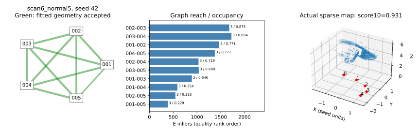
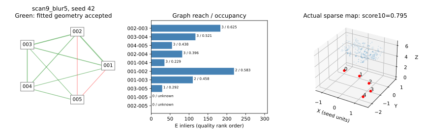
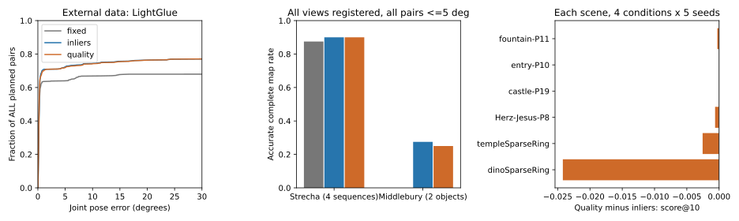
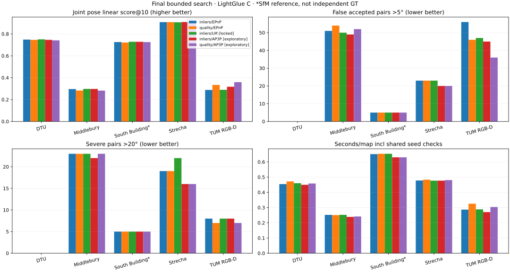

# Stage 7B：几何质量驱动的 SfM 初始化

本轮完成真实实现、480 次有界重建和 20 个 COLMAP 参考条件。**简单多候选初始化在新增物体上有工程收益；本轮几何质量评分没有优于简单内点排序，不能作为已验证的算法创新。** 所有配置保持原冻结规则，没有根据新测试结果继续调参。未提交、未推送、未合并 main。

## Stage 7A 最小验收

只读复算旧 C / MAGSAC / MSAC 的 1,380 个缓存位姿评分，全部一致；核对 235 个匹配来源文件及原图、K、映射哈希。Stage 7B 又实际重算并逐数组核对 312 个历史条件—前端—种子—候选位置，E/H、掩码、位姿、三角化均与原 MSAC 产物完全一致。

| 前端 C 的几何后端 | scan1 线性位姿分数@10 | scan6 |
|---|---:|---:|
| 旧 RANSAC | 0.6027 | 0.5722 |
| MAGSAC 配置 | 0.7292 | 0.7285 |
| MSAC 1.5 px | 0.7481 | 0.7354 |
| MSAC 1.0 px 消融 | 0.7545 | 0.7381 |

收益属于 OpenCV USAC 求解器配置、局部优化及内部收尾等整套后端变化，不能单独归因为 MSAC 分数函数，更不是本人原创求解器。两种新后端使用原始像素与完整 K 的原生接口，旧后端采用归一化坐标接口；这些数值路径差异也属于此次后端替换，而不是纯打分消融。

1.0/1.5 px 的 460 个配对位置出现 16 次正确性恢复、8 次退化；错误接受 43→35，但严重错误 17→18。`scan6_blur_002_005 / seed51` 的旋转/平移方向误差从 1.110°/0.723° 变成 30.625°/103.317°。E 内点 101→80，交集 72、并集 109；保留点 101→44。两个 E 均满足近似等奇异值、秩二约束，但不是同一个 E 或同一支持集。原四解分解由 101/0/0/0 的正深度支持变为 15/65/0/0，选中后正深度比例仍有 0.8125，保留点中位视差 1.224°，中位最大视图重投影仅 0.165 px。H 支持 64/146=43.8%，未触发 90% 的主导门。现有低残差、正深度、视差与 H/E 门允许错误模型通过；这不是已经证明的“平面退化根因”。阈值扰动改变了估计支持及解，具体物理歧义尚未被唯一识别。旧记录 `normalized_ransac_threshold` 来自未改动的外层配置；实际 USAC 阈值应读 `effective_normalized_essential_threshold`，1.0 px 为 0.00069258。

SIFT/RootSIFT/LightGlue 的受控前端对比已完成：原后端下，scan1 的 A/B/C 分数约 0.6068/0.5429/0.6027，scan6 约 0.2627/0.4760/0.5722。RootSIFT 已贡献显著变化；LightGlue 有增益也有退化，不能把 C 相对 A 的全部变化算作学习匹配贡献。scan1/scan6 都是反复分析过的开发证据；460 个位置不是 460 个独立场景。

**Stage 7B 固定使用 MSAC 1.5 px，保留 1.0 px 为历史消融，停止阈值搜索。** 未解决的风险是错误几何也能通过接受门，以及正确种子不保证后续 PnP 正确。

## 实现与公平协议

- [冻结配置 v2](../configs/experiments/stage7b_initialization_v2.json)：开发物体 scan1/6；新增独立物体 scan9/10/11；各自 normal5、reduced3、spaced3、blur5；种子 42/43/44。共 5 个物体、20 个相关条件。
- 已知完整 K，800×600 RGB；复用 Stage 7A 4096 目标特征及 RootSIFT 规范。两个固定前端分别是 RootSIFT+互检比率匹配（B）和同一 RootSIFT+官方 LightGlue（C）。它们不是策略 A/B/C 的命名。
- 固定种子：001/003，spaced3 为 001/020；简单方案：通过原几何检查的候选优先，再按 E 内点数排序；质量方案：先比较能连接到其他视图的无歧义种子地标支持，再比较两幅图的最小 8×6 网格覆盖率，最后比较内点数。未知覆盖率明确为 null。
- 第三视图支持只复用已有双向身份冲突拒绝和 PnP 最少 12 点要求；不使用 GT，不额外拟合 PnP 来打分。候选对在同一场景有相同图像数，连接数量可直接比较；覆盖率以图像面积归一化。没有引入跨场景学习权重。
- 结构性筛查认为内点和保留点嵌套，拟合残差、视差等不能当独立正确性证据，因此没有机械加权全部信号。事后描述性检查显示内点与保留点 Spearman ρ≈0.994、与覆盖率≈0.764。相关性统计未用于重选规则。
- B/C 和“去掉连接图信号”消融均使用相同候选、MSAC、接受门、最多 3 次种子尝试、同一单次顺序 PnP 与三角化。预验证已通过的第一个种子被接受后停止尝试；**本轮所有运行实际只尝试 1 个种子**。因此收益主要来自候选搜索与种子选择，不能声称来自多次完整重建恢复或 PnP 重试。
- 仅对原 [incremental.py](../src/georecon/teaching/incremental.py) 增加可选缓存特征、对应和已验证种子接口；默认路径保持原行为。新策略在 [initialization.py](../src/georecon/teaching/initialization.py)。复用原 PnP、DLT 和 [教学 BA](../src/georecon/teaching/bundle_adjustment.py)，没有复制 SfM。
- BA 明确采用新资源配置：最多 20 次函数评估、5 秒，所有方法相同；超过结构预算或拒绝候选时保留原图，不缩减点或观测。仅优化已注册相机，不新增注册。

指标：配对误差为旋转角与有方向平移角的最大值；正确≤5°，严重>20°。所有计划相机对进入分母，未注册的位姿分数为 0。表中“分数@T”沿用 `mean(max(0,1-error/T))` 的 Stage 7A 定义，明确区别于未说明实现的标准 Pose AUC。完整准确重建要求全部相机注册且全部计划对正确；正确初始化评价 BA 前的种子。表中错误率按条件等权、物体等权，不等于直接将不同视图数的所有配对混合计数。

## 新独立物体：主结果

以下仅固定 LightGlue 前端。36 次运行是 **3 个物体×4 条件×3 随机种子**，不是 36 个独立场景；每方法 234 个计划配对位置。

| 指标 | 固定种子 A | 内点排序 B | 质量排序 C |
|---|---:|---:|---:|
| 正确初始化 | 25/36，69.4% | 36/36，100% | 36/36，100% |
| 完整准确重建 | 22/36，61.1% | 24/36，66.7% | 24/36，66.7% |
| 平均注册相机 | 3.167 | 3.667 | 3.667 |
| 相对种子锚点正确相机¹ | 2.972 | 3.667 | 3.667 |
| 所有关联计划对均正确的相机 | 2.611 | 2.833 | 2.833 |
| 分数@5 / @10 / @20 | .5705 / .6259 / .6574 | .6970 / .7485 / .7742 | .6906 / .7453 / .7727 |
| 错误接受位置 | 16/234 | 0/234 | 0/234 |
| 条件宏平均错误率 | 4.44% | 0% | 0% |
| 严重错误位置 | 10/234 | 0/234 | 0/234 |
| 条件宏平均严重率 | 2.78% | 0% | 0% |
| 已注册对 P95 / 最大误差 | 29.36° / 125.21° | 1.45° / 1.79° | 1.75° / 2.95° |
| 平均稀疏点 | 875.1 | 1075.5 | 1072.8 |
| 候选几何+增量+BA 秒/运行² | .504 | .468 | .492 |

¹ 锚点本身按坐标规范计为一个；因此另列所有关联对均正确的保守口径。² 共享匹配缓存，排除特征、匹配、加载与落盘；不作为部署端到端提速证据。固定种子也被计入相同的全候选预计算成本；部署时它本可只估计固定一对。B/C 的尝试上限相同，不表示实际耗时必须相等。

各独立物体 @10：

| 物体 | 固定 | 内点 | 质量 | 质量−内点 |
|---|---:|---:|---:|---:|
| scan9 | .6834 | .7675 | .7575 | −.0100 |
| scan10 | .6305 | .7865 | .7871 | +.0006 |
| scan11 | .5639 | .6914 | .6914 | 0 |

简单方案改善了三个新物体的宏平均评分，但完整准确重建仅增加 2 个“条件—种子”位置。其 @10 增幅约 0.1225 中，约 0.0804 来自 spaced3 从空重建恢复为**两相机部分图**；没有因此完成三相机准确重建。不能把这一部分解释为完整场景恢复。

**C 未通过冻结的继续标准**：没有比 B 多恢复完整准确图或正确相机，@10 低 0.00316，scan9 退化。保留简单 B 为工程候选，不提升 C 为新算法默认值。


## 消融、失败和归因

| 独立物体，RootSIFT 比率匹配固定前端 | 正确初始化 | 完整准确图 | @10 | 错误/严重位置 |
|---|---:|---:|---:|---:|
| 固定 | 44.4% | 27.8% | .3507 | 36 / 36 |
| 内点 | 88.9% | 33.3% | .5016 | 19 / 0 |
| 质量 | 94.4% | 36.1% | .5155 | 14 / 0 |
| 质量去掉连接图 | 94.4% | 36.1% | .5159 | 14 / 0 |

弱前端下覆盖率排序有局部改善，但没有跨前端稳定收益；去掉连接图并未损失主结果。LightGlue 下质量与去连接图消融结果完全相同，因此没有证据支持连接图项的独立贡献。固定内点策略时，RootSIFT 比率匹配→LightGlue 的 @10 为 .5016→.7485、错误位置19→0；这是前端替换证据，不能记为质量评分创新。

代表性结果与边界：

- **新增物体恢复**：scan10_blur5 的完整准确图由 2/3→3/3、错误/严重位置10/10→0/0；scan11_normal5 由2/3→3/3，错误2→0。这些是简单种子选择收益，C 没有额外恢复。
- **C 的旧数据改善**：scan6_normal5 @10 从内点方案 .842→质量 .925，均完整准确。它是开发证据，不能抵消独立测试退化。
- **C 的新数据退化**：scan9_blur5 @10 .875→.836；质量规则偏好002/003，内点规则偏好001/002。更广覆盖或更多潜在连接不保证后续 PnP 精度。seed44 最后一个视图只有12个PnP内点，刚好达到原门；BA前已有差异，不能只归咎于BA。
- **重要反例保留**：旧 scan6_spaced3，固定种子无图，B/C 接受001/010并错误注册020；每3个种子共6个错误且严重的配对位置，最大约58.80°。seed42 的020有49个唯一2D–3D链接、15个PnP内点，BA收敛仍未恢复正确位姿。正确种子100%不代表注册可靠。
- **普通条件退化**：RootSIFT比率前端的scan11_reduced3，固定方案完整准确3/3，B/C仅1/3。不能宣称任何前端下选内点最多都稳定优于固定种子。
- 新物体的spaced3均未实现完整准确三视图重建；scan11_blur5仍只有4/5相机，保留在失败分母内。没有删除失败场景。




图中绿色只表示通过拟合几何门，点云是实际稀疏结果、单位为种子基线；不是稠密模型或真值点云质量证明。完整精简矩阵见 [结果 CSV](results/stage7b_initialization.csv)。

## COLMAP 参考、成本与验收

保留原 `configs/methods/colmap_stage3.json`、PyCOLMAP4.2.1 CPU流程：自估共享 PINHOLE、8192目标特征、单种子42、每条件180秒。输入为相同处理图像。独立12条件中，完整准确图4/12，平均注册2.50，@5/10/20=.3083/.3833/.4208，错误/严重位置3/3（每条件单次）；平均总耗时 .989 秒。其内参、匹配和后端均与已知K教学流程不同，**不能据此宣称本方法在公平条件下超过COLMAP**。初始种子正确性未从原适配器导出，明确 unknown。详见 [参考结果](figures/stage7b_initialization/colmap_reference.csv)。

最终480次运行全部执行完，无进程错误、OOM或BA超时：360次主对照+120次去图消融。BA收敛接受64次、达到迭代预算但非收敛接受257次、少于三注册相机99次、无种子图36次、结构预算拒绝24次。后3类保留原图，不伪报BA完成。观察重投影中位数的运行间中位数（固定/内点/质量）为.216/.179/.177px，只是内部一致性；未评估GT点云精度。

最终SfM实验主体137.01秒；COLMAP20条件累计23.01秒。此处不把首轮中断、数据准备、测试、I/O或报告算作同一端到端计时。CPU SfM峰值RSS138.8MiB，COLMAP峰值约773.4MiB；新增匹配算子合计1.56秒，不含特征、模型载入、下载等。LightGlue最大分配约267MiB、保留约494MiB；100ms整卡采样峰值1579MiB，包含桌面，低于12GiB。SfM/BA本身CPU运行，没有为了图形加速改变算法。

软件失败保留：首次预测在计算前因“原配置与JSON快照空白不同却比较字节哈希”终止，修复为原文件哈希加快照语义核对；首轮预处理将新图像在缩小后模糊，发现与旧blur5语义不同后，在新物体策略预测前停止。v2严格恢复为原图半径4再缩小，规则/阈值/种子未改变；已有新原图直接复用。首轮配置 [v1](../configs/experiments/stage7b_initialization_v1.json)、中断记录、全部已有运行与参考结果留存，本报告仅统计v2。[DTU官方数据页](https://roboimagedata.compute.dtu.dk/?page_id=36)提供Rectified与SampleSet；字节范围读取首次51,378,141字节，修正准备只重新读取7,084,115字节索引，累计约58.5MB；没有整包下载。

验证：主环境229项，**228通过、1跳过**（原生PyCOLMAP测试要求独立环境）；COLMAP环境该适配器10项全部通过，覆盖前述跳过项。新增10项涵盖坐标与对应身份、冲突、排序/未知、尝试上限、退化及两处实际软件失败回归。另对旧默认接口回放，3个相机、1793个点和全部中间数组与HEAD版本完全相同。保留全部历史文件；仅扩展原增量入口，不改旧算法默认值或历史产物。

最终维护将评价CSV导出改到调用者指定输出目录，避免复现时覆盖仓库展示指标；全部480条评价及CSV只读重导出完全一致。预测归档源码保持原样，检查器只允许这一行导出路径变化并显式记录新旧哈希，不将维护后的整份脚本冒充当时的预测源码。图表同样输出到显式新目录。

## 复现与依赖

CPU数学与策略测试可独立运行；实际对照需要历史Stage7A特征/匹配缓存、旧DTU小样本和cal18、固定LightGlue第三方源码/权重及相应环境。缓存、权重、原图和大量运行文件留在 `outputs/` / `data/`，没有纳入Git；缺少历史缓存不能声称从新克隆即可直接复现表格。COLMAP使用独立PyCOLMAP4.2.1环境。第三方网络、权重和模型能力不属于本人实现。

在仓库根目录、激活相应环境后执行；`LIGHTGLUE_SOURCE`/`LIGHTGLUE_WEIGHTS`由使用者显式指定，输出必须使用新目录：

```bash
PYTHONPATH=src OPENBLAS_NUM_THREADS=8 python -m unittest discover -s tests -v
PYTHONPATH=src OPENBLAS_NUM_THREADS=8 python scripts/check_stage7b_baselines.py \
  --cache outputs/stage7a_v1_after_guard_fix --stability outputs/stage7a_backend_stability_v1 \
  --refinement outputs/stage7a_msac_refinement_v3 --source "$LIGHTGLUE_SOURCE" \
  --weights "$LIGHTGLUE_WEIGHTS" --config configs/experiments/stage7b_initialization_v2.json \
  --output outputs/stage7b_new_audit
PYTHONPATH=src OPENBLAS_NUM_THREADS=8 python scripts/run_stage7b_initialization.py prepare \
  --config configs/experiments/stage7b_initialization_v2.json \
  --cache outputs/stage7a_v1_after_guard_fix --source "$LIGHTGLUE_SOURCE" \
  --weights "$LIGHTGLUE_WEIGHTS" --output outputs/stage7b_new
PYTHONPATH=src OPENBLAS_NUM_THREADS=8 python scripts/run_stage7b_initialization.py predict --output outputs/stage7b_new
PYTHONPATH=src OPENBLAS_NUM_THREADS=8 python scripts/run_stage7b_initialization.py evaluate --output outputs/stage7b_new
# 切换到COLMAP环境；共享匹配缓存不用于此参考流程。
PYTHONPATH=src OPENBLAS_NUM_THREADS=8 python scripts/run_stage7b_colmap_reference.py \
  --study outputs/stage7b_new --config configs/methods/colmap_stage3.json --output outputs/stage7b_colmap_new
# 切回包含Matplotlib/SciPy的实验环境。
PYTHONPATH=src OPENBLAS_NUM_THREADS=8 python scripts/check_stage7b_initialization.py \
  --study outputs/stage7b_new --baseline outputs/stage7a_backend_stability_v1 \
  --cache outputs/stage7a_v1_after_guard_fix --report outputs/stage7b_new/checks.json
PYTHONPATH=src OPENBLAS_NUM_THREADS=8 python scripts/report_stage7b_initialization.py \
  --study outputs/stage7b_new --colmap outputs/stage7b_colmap_new --output outputs/stage7b_figures_new
```

最终本地证据为 `outputs/stage7b_initialization_v2/`、`outputs/stage7b_colmap_reference_v2/`；v1失败证据保持原位置。初始化、注册和BA进程有GT文件读取保护，离线评价另读真值。数据准备会从官方投影矩阵分解K并封装单独的R/t真值文件，不能声称准备阶段从未接触外参；特征/匹配代码只接收RGB或特征，排序和重建进程不读这些外参。输入、源码快照、协议和权重可追溯；所有计划分母及312个历史几何位置均由检查器验证。

## 贡献、局限与决策

累计贡献是统一坐标和失败协议、可审计的基线/融合负结果、本人实现的教学SfM/PnP/DLT/BA链及本轮缓存匹配接口、可解释种子选择、受控消融和新物体验证。MSAC、RootSIFT、LightGlue、COLMAP和SciPy求解器明确归属第三方。本轮支持“候选搜索与简单种子选择可改善部分实际失败”，不支持“连接图质量评分形成新的稳定性能提升”。

简历可写：**实现已知内参的增量SfM与可插拔匹配、种子选择及BA流程；在3个新增DTU物体的固定小样本上，将LightGlue前端的正确初始化率69.4%提升至100%、完整准确重建率61.1%提升至66.7%，并保留旧场景注册退化与质量排序负结果。** 应注明条件与随机种子重复，不能写成大规模标准DTU成绩、超过COLMAP或原创鲁棒求解器。

独立性局限：只有3个新增物体，使用相同DTU采集轨迹、光照和人工模糊；12条件和36次运行相关，不作显著性或广泛泛化承诺。BA预算有限，部分结构超预算；正确初始化、低残差和更多点都不能证明完整重建正确。当前不能将B作为所有条件下稳定无伤害的默认替换。

**停止本轮C评分扩展，不叠加新权重。下一步只建议研究“PnP注册后的跨视图几何验证”，以scan6宽视角15/49内点却严重错误的案例为起点，重点控制错误注册，而非继续搜索种子分数。** 本轮没有实现该方向，等待审查。

## 2026-10-18：跨数据集稳定性复核与保留决定

**优先保留内点排序作为后续研究参考，几何质量排序仅保留显式候选及消融证据。** [保留配置](../configs/teaching/initialization_selection.json)记录决定；没有改变旧算法默认接口、删除质量排序或把研究候选自动上线。当前不能证明任一排序是稳定安全的生产替换。

外部数据新增两类：Strecha的fountain-P11、Herz-Jesus-P8、entry-P10、castle-P19四个采集序列，以及Middlebury的templeSparseRing、dinoSparseRing两个物体。每个输入保留normal5/reduced3/spaced3/blur5四种条件、五个种子42–46，两个固定前端和三个策略，共720次运行。只有6个场景/物体单元；四个建筑序列不等于已证明完全独立的四个地理地点。条件与种子均相关，不当作720个独立样本。

[冻结协议](../configs/experiments/stage7b_cross_dataset_v1.json)在下载图像前固定：排序、几何阈值、最大3次尝试、PnP和BA完全沿用v2；首五张、首三张和固定索引宽间隔三张仅由文件名顺序确定，不用GT挑视图。`normal5`只是兼容命名，不保证新数据中相邻文件就是近视角，`spaced3`也不保证等角度间距。Strecha保持比例缩到800×533；Middlebury保持原生640×480、不放大；所有方法共用相同预处理、K和匹配缓存。模糊仍先在原图施加半径4，再缩放。这是明确的新数据资源配置，不与旧DTU输入宣称完全相同难度。

Strecha采用[OpenMVG公开评测镜像](https://github.com/openMVG/SfM_quality_evaluation/tree/348a981ef51112e9848acfb20004f4ed6fbc6ce3)，图像为该镜像的JPEG版本，不声称与原始PNG逐像素相同；每个文件通过固定Git blob校验。[官方读取代码](https://github.com/openMVG/openMVG/blob/6887e7385400f4cca378507296ccc20c8a0837dd/src/software/SfM/import/io_readGTStrecha.hpp)明确使用`R=R_file.T, t=-R*C`。Middlebury按[官方格式](https://vision.middlebury.edu/mview/data/)直接读取`P=K[R|t]`；官方说明其标定精度约为像素量级。参考R仅做十进制舍入后的正交化，最大元素修正约7.5e-7，不拟合图像或推理位姿。准备阶段解析K与独立真值文件，重建进程禁止读取原始标定和真值，评价再读取。新的[数据适配器](../src/georecon/data/calibrated_benchmarks.py)及[4项坐标测试](../tests/test_calibrated_benchmarks.py)保留这些差异。

### 主要对照：固定LightGlue前端

表中错误/严重数是计划相机对—条件—种子位置，包含相关重复；Strecha每策略520个计划配对位置、Middlebury260个。完整准确图仍要求全部相机注册、全部计划对≤5°；评分定义沿用前文，未注册对保留分母。

| 数据集 | 排序 | 正确初始化 | 完整准确图 | @5 / @10 / @20 | 错误 / 严重位置 |
|---|---|---:|---:|---:|---:|
| Strecha，80运行/策略 | 内点 | 96.25% | 90.0% | .8909 / .9076 / .9163 | 23 / 19 |
| Strecha | 质量 | 96.25% | 90.0% | .8905 / .9074 / .9162 | 23 / 19 |
| Middlebury，40运行/策略 | 内点 | 32.5% | 27.5% | .2465 / .2962 / .3544 | 51 / 23 |
| Middlebury | 质量 | 30.0% | 25.0% | .2420 / .2828 / .3416 | 54 / 23 |

内点排序在6个场景的平均@10均不低于质量排序：4个略高、2个相同。但Strecha差异仅约0.00022，应视为近似持平；Middlebury差异约0.01338，质量排序多3个错误位置，少恢复1个准确图。每个数据集的五个种子中，质量排序仍有两个种子的均分略高，不能宣称内点排序逐种子必胜或已证明统计显著优势。

关键反例为dinoSparseRing_reduced3、seed45：内点排序选002/003，质量排序选001/002；两者潜在可达视图数均为1，质量规则优先0.3958而非0.375的网格覆盖率，放弃54内点而选48内点。后续PnP内点20→14，准确完整图由成功变为失败，@10由.5388→.0548。**一个网格的覆盖差不保证更正确的几何。** 此失败明显影响Middlebury均值，保留逐种子结果以显示波动。



### 不能忽略的风险和前端取舍

- 相对固定种子，内点排序在Strecha的完整准确率87.5%→90%，但严重位置0→19，最大误差约98.93°；新增风险集中于entry-P10。@10提高不能抵消这一尾部退化。
- Middlebury固定种子没有准确完整图，内点排序恢复11/40，但严重位置7→23，已注册对P95约149.75°、最大168.75°。因此两种排序都没有解决无纹理物体和大视角的错误接受。新增数据未因失败移出分母。
- 固定RootSIFT比率前端时，质量排序在Middlebury的@10由.0753→.1042、完整准确率0→2.5%，同时错误13→18、严重8→13。这是可见的平均分/尾部风险取舍，不能混入LightGlue主结论或据此宣称质量排序稳健更优。
- 简单推理代理仍可能同错：dino失败种子的正深度比例为1且视差、覆盖均看似合理。官方README说明该物体无纹理、黑背景且部分图像出视场；本轮保留这些实际难例，没有另选更好视图或修改门限。

完整[数据集汇总](results/stage7b_cross_dataset.csv)、[逐场景配对差异](results/stage7b_cross_dataset_scenes.csv)同时保留两前端与固定种子。RootSIFT与LightGlue能力属于第三方前端，本轮的贡献是可审计的外部验证和选择边界，不是新的几何算法。新数据已用于这一轮保留决定，此后应视为外部验证集，不再称未触碰的最终盲测。

### 检查、成本与复现

720次全部执行，独立复算4680个配对位姿评分及272份匹配身份，重新解析40份选中视图标定并核对全部下载哈希，输入与源码哈希、算法冻结、GT读取保护全部通过；没有OOM、进程错误或BA超时。BA收敛接受153次、迭代预算内未收敛接受294次；少于三相机155次、无种子103次、结构超预算13次、候选有限性/正深度/目标检查拒绝2次，均保留原图和候选，不伪报收敛。

实际下载84,029,617字节（只取必要Strecha文件和两个约4MB官方Middlebury包），准备主体69.05秒；重建主体188.04秒，不含下载、评价、测试、报告。候选几何+增量+BA每运行，LightGlue内点/质量在Strecha约.497/.501秒，Middlebury约.257/.256秒；为缓存匹配后的计时，不能当作部署端到端延迟。CPU峰值RSS约142.4MiB；GPU分配约242MiB、保留408MiB，100ms整卡采样峰值1198MiB，包含桌面，低于12GiB；SfM/BA仍用CPU。

本地主环境233项，**232通过、1跳过**：原生PyCOLMAP需要另一环境，本轮未修改其适配器；新增4项格式/坐标/缩放测试全部通过。本轮没有重新训练、下载权重、开展PnP新策略或改动排序规则。

代码入口为[跨数据集运行器](../scripts/run_stage7b_cross_dataset.py)和[验证与画图](../scripts/report_stage7b_cross_dataset.py)。实际证据在`outputs/stage7b_cross_dataset_v1/`，所有输出拒绝覆盖。先准备只有元数据的固定数据镜像（避免整包clone图像），使用原LightGlue环境、历史特征配置缓存及显式第三方源码/权重路径：

```bash
git clone --filter=blob:none --no-checkout --depth 1 https://github.com/openMVG/SfM_quality_evaluation.git "$STRECHA_METADATA"
# rev-parse HEAD应为协议中的348a981ef51112e9848acfb20004f4ed6fbc6ce3，否则停止核对版本。
PYTHONPATH=src OPENBLAS_NUM_THREADS=8 python scripts/run_stage7b_cross_dataset.py prepare \
  --output outputs/cross_dataset_new --config configs/experiments/stage7b_cross_dataset_v1.json \
  --cache outputs/stage7a_v1_after_guard_fix --metadata "$STRECHA_METADATA" \
  --source "$LIGHTGLUE_SOURCE" --weights "$LIGHTGLUE_WEIGHTS"
PYTHONPATH=src OPENBLAS_NUM_THREADS=8 python scripts/run_stage7b_cross_dataset.py predict \
  --output outputs/cross_dataset_new --config configs/experiments/stage7b_cross_dataset_v1.json
PYTHONPATH=src OPENBLAS_NUM_THREADS=8 python scripts/run_stage7b_cross_dataset.py evaluate \
  --output outputs/cross_dataset_new --config configs/experiments/stage7b_cross_dataset_v1.json
PYTHONPATH=src OPENBLAS_NUM_THREADS=8 python scripts/report_stage7b_cross_dataset.py \
  --study outputs/cross_dataset_new --prior outputs/stage7b_initialization_v2 \
  --output outputs/cross_dataset_review_new
```

无需这些数据或模型即可运行四项CPU格式测试：`PYTHONPATH=src python -m unittest discover -s tests -p test_calibrated_benchmarks.py -v`。模型缓存、数据、完整预测与日志继续留在Git之外。累计新增能力是跨基准的标定适配、冻结配置验证及场景级稳定性诊断；优先内点排序是一项有边界的工程选择，不是已建立普遍稳定收益或算法新颖性。

<a id="final-five-dataset-search"></a>

## 2026-10-18：最后一轮五数据来源对照

**决定：内点排序和质量排序都保留，不设置统一优胜默认；新增AP3P作为有收益也有退化的实验候选。没有通过跨数据集稳定替换门。** 原MSAC 1.5 px、原教学命令和生产默认不变。本轮不进入下一阶段、不提交或推送。

### 固定方案与数据边界

[初始冻结配置](../configs/experiments/stage7b_final_search_v1.json)限定四组：原EPnP、EPnP+LM、AP3P、AP3P+LM。AP3P仅替换PnP RANSAC的最小求解器；LM在已接受注册上最多三轮、每轮20次迭代，以完整K的正深度2px支持和截断平方代价作回退保护。匹配、MSAC、PnP门槛/1000次RANSAC、三角化、已知固定K和BA预算不变，不用GT选相机或修改门槛。标准AP3P/LM来自OpenCV，不宣称新的求解器。

开发阶段仅用scan1/6，四条件、五种子42–46、B/C前端、两排序和四求解器，共640张地图。在读取开发指标之前，[补充冻结配置](../configs/experiments/stage7b_final_search_v2.json)增加固定种子对照，确保能检查已有排序相对固定种子的风险；没有改变数据或算法。开发规则锁定LM：分数.776951→.778484，错误/严重均10/10不变；p95却由2.838°升至3.870°。随后才运行外部5,760张地图；其他三个求解器同时保留，AP3P的后续优先级属于**探索性选择**，不能冒充预先锁定的独立确认。

| 数据来源 | 外部场景 | 条件与参考 |
|---|---:|---|
| DTU | scan9/10/11，共3个 | 复用原四条件和图像，已反复查看的历史留出对象，不是新盲测 |
| Strecha | 4个 | 复用前轮缓存；标定参考及镜像版本限制沿用前文 |
| Middlebury | 2个 | 复用temple/dino sparse ring；标定存在像素级误差 |
| TUM RGB-D | 2段 | fr1_xyz、fr1_desk；官方TAR前缀内首先出现的7张RGB，按文件名排序，不按质量/重叠/GT挑选；仅RGB，不用深度 |
| South Building | 1组 | 官方COLMAP样例128图中固定文件序号0–4/63/127；**提供的SfM重建位姿是参考，不是独立GT** |

每场景normal5/reduced3/spaced3/blur5、五种子、B/C、固定/内点/质量三排序、四PnP，共48条件×120=5,760张地图。12个外部场景加2个开发对象，不能将6,400次相关重复当成6,400个独立样本。TUM的normal5只是兼容条件名，图像在时间上可能相隔较远。TUM用官方fr1 RGB内参/畸变去畸变，保留黑边、不裁剪；参考为彩色相机光心C2W四元数，反转为W2C，最近时刻上限20ms，实际最大5.025ms。South Building用SIMPLE_RADIAL去畸变，再等比缩至800×600内。均先在原分辨率做radius4模糊；各方法共享相同预处理和特征。

来源：[TUM格式及标定](https://cvg.cit.tum.de/data/datasets/rgbd-dataset/file_formats)、[TUM下载](https://cvg.cit.tum.de/data/datasets/rgbd-dataset/download)、[COLMAP样例说明](https://colmap.github.io/datasets.html)、[官方South Building 3.11.1资源](https://github.com/colmap/colmap/releases/download/3.11.1/south-building.zip)、[COLMAP文本坐标约定](https://colmap.github.io/format.html#text-format)、[OpenCV PnP精化接口](https://docs.opencv.org/4.x/d9/d0c/group__calib3d.html)。TUM官方针对RGB-D预注册深度不建议直接去畸变；本轮只用RGB，未把处理后的RGB与原深度混用。

### 结果：局部收益成立，跨数据集稳定收益未成立

下表只改变PnP，固定LightGlue C和内点排序；分数是全计划配对分母的线性联合位姿分数@10，**不是点云精度，也不是标准CDF-AUC**。错误/严重为>5°/>20°的已接受配对种子位置；South Building列为相对SfM参考的差异。

| 数据 | 原EPnP→AP3P分数 | 差值（百分点） | 错误接受 | 严重错误 | 完整准确率变化 |
|---|---|---:|---|---|---|
| DTU | .748230→.745765 | −0.247 | 0→0 | 0→0 | 66.7%不变 |
| Strecha | .907622→.908607 | +0.098 | 23→20 | 19→16 | 90.0%不变 |
| Middlebury | .296157→.297253 | +0.110 | 51→49 | 23→22 | 27.5%不变 |
| TUM RGB-D | .288048→.317460 | **+2.941** | **56→45** | 8→8 | 12.5%不变 |
| South Building* | .725635→.727801 | +0.217 | 5→5 | 5→5 | 75.0%不变 |

TUM内点排序错误接受减少19.6%，已接受配对数138→144，没有靠全盘拒绝换下降；正确配对82→99，但完整准确地图仍5/40不变。xyz/desk的场景分数各增加.029499/.029324；五个种子的场景宏平均差均为正，**不代表所有条件都改善**。五数据来源等权分数增加0.624个百分点，不能掩盖全部三个DTU对象的小幅下降。

对已保留的质量排序，TUM同样有AP3P增益：.333913→.359023（+2.511个百分点），错误46→36（−21.7%）、严重7→7；五种子宏平均也都为正。质量排序在这个新数据来源上优于内点排序，但DTU和Middlebury仍落后，故撤销“统一优先内点”的选择状态，**两种排序都显式保留，不做按测试集标签切换的自动规则**。不可把“内点/EPnP→质量/AP3P”的叠加差值全部归给AP3P。

预选LM的正式稳定门失败：Strecha分数.907622→.906338，严重19→22；AP3P+LM也在TUM增加严重8→11。RootSIFT-ratio B的AP3P则将DTU完整准确22/60→23/60、错误19→16，但TUM严重10→11；前端间没有统一安全性。完整三排序/四求解器/B/C指标见[120行汇总](results/stage7b_final_search.csv)，AP3P内点排序全部240个配对运行见[逐项变化与缓存路径](results/stage7b_final_ap3p_pairs.csv)。所有未初始化、未注册、超预算及负结果均保留在原分母。



### 代表性收益与失败

- TUM xyz blur5/seed45：内点排序下分数.092183→.438545，注册4→5，但错误6→5，仍然不是完整准确重建。
- **TUM xyz blur5/seed43反例**：分数.147289→.006867，注册3→2；同一条件仍有明显回退。不能称每次都鲁棒。
- DTU scan11 blur5/seed43：分数.552700→.505107，注册4/4不变，错误仍0；位姿变差没有反映成接受率变化。三个DTU对象AP3P分数均下降。
- Middlebury temple的AP3P分数下降.003258，dino上升.005448；Strecha entry上升.004750，但fountain/castle略降。宏平均改善不意味着每场景改善。
- LM在entry blur5/seed45的严重错误7→10、分数.139163→0；更低的拟合代价并不保证真实位姿正确。

**保留判断：** AP3P值得作为可选工程候选，尤其TUM两段的局部收益；不自动替换旧PnP，不叠加LM，不按已知数据集挑方法。正式预选LM失败，AP3P是看完本轮矩阵后的候选，尚无独立确认；也未通过“各数据来源不退化”的稳定门。原固定种子相较某些排序更少严重错误的问题未消失。不能宣称“找到了普遍更优解”“提高稠密重建精度”或“原创算法”。

### 检查、资源与复现

全矩阵5,760/5,760完成，重新计算37,440个计划配对位姿槽，核对所有输入/源文件哈希、推理GT访问隔离，并重解析21台新增相机参考。936次可匹配的历史基线BA前位姿/种子完全一致；历史480张地图及312组E/H/三角化数组的独立只读检查也通过。106次BA后有小数值差异，最大配对角差.001147°、单次分数差.00002962，完整率/错误/严重/注册等离散结论均不变；没有声称BA逐位相等或认定差异只来自舍入。本轮各对照均重新在同一执行配置下计算。

原三进程串行调度的941条已完成记录及中断信息保存在`outputs/stage7b_final_{dtu,old_external,new_external}_v2/`，不当作完整对照或性能失败；为缩短耗时，完整重跑使用8个独立CPU进程，不共享被替换的PnP全局函数。每进程仍沿用OpenCV线程上限8，BLAS/OMP线程上限1；8进程的潜在线程总上限高于原单进程8线程，不能宣称总CPU资源预算未变，也不据此宣称算法加速。各方法同组运行，BA未发生墙钟超时。开发计算198.04s；中断前串行前缀约87.55s（并行发生，不能相加）；完整外部矩阵281.44s。新增数据准备38.12s（不含更早的ZIP元数据探测），其中匹配2.42s。正式数据传输40,128,053B，另有约4.22MB前置范围探测，未下载完整大压缩包。GPU用于匹配，100ms采样整卡峰值2,425MiB；Torch峰值分配484MiB、保留1,554MiB；几何阶段GPU为0。8进程峰值RSS之和约789MiB，无OOM、进程错误或BA超时，BA拒绝和预算未收敛均保留。

CPU套件240项：239通过，1项因当前环境没有PyCOLMAP跳过；在独立COLMAP环境另跑适配器10项全部通过，包含原生测试。未提交/推送，**没有触发新GitHub CI**。原始配置、地图、失败、GPU曲线、来源和测试日志位于`outputs/stage7b_final_external_v3/`，开发选择在`outputs/stage7b_final_development_v1/`，数据及首版准备脚本在`outputs/stage7b_final_data_v1/`。数据准备脚本事后仅补齐从新输出目录抓取元数据的入口和哈希检查，未重做图像/匹配/推理；首版源码与哈希保留。

以下复现依赖本地历史DTU/Strecha/Middlebury缓存、固定LightGlue源码/权重，以及具有NumPy/OpenCV/SciPy/Torch的既有环境；不能把纯Git检出或CPU CI说成可直接完整运行本实验。`LIGHTGLUE_SOURCE`、`LIGHTGLUE_WEIGHTS`需显式设为已核对的本地位置。所有新输出必须不存在。

```bash
PYTHONPATH=src OPENBLAS_NUM_THREADS=1 python scripts/run_stage7b_final_search.py predict \
  --output outputs/final_dev_new --config configs/experiments/stage7b_final_search_v1.json \
  --bundle outputs/stage7b_initialization_v2 --development
PYTHONPATH=src python scripts/run_stage7b_final_search.py evaluate \
  --output outputs/final_dev_new --config configs/experiments/stage7b_final_search_v1.json
PYTHONPATH=src python scripts/run_stage7b_final_search.py select \
  --output outputs/final_dev_new --config configs/experiments/stage7b_final_search_v1.json
PYTHONPATH=src python scripts/prepare_stage7b_final_data.py \
  --output outputs/final_data_new --config configs/experiments/stage7b_final_search_v2.json \
  --source "$LIGHTGLUE_SOURCE" --weights "$LIGHTGLUE_WEIGHTS" \
  --cache outputs/stage7a_v1_after_guard_fix --prior outputs/stage7b_initialization_v2
PYTHONPATH=src OPENBLAS_NUM_THREADS=1 OMP_NUM_THREADS=1 python scripts/run_stage7b_final_search.py predict \
  --output outputs/final_external_new --config configs/experiments/stage7b_final_search_v2.json \
  --bundle outputs/stage7b_initialization_v2 --bundle outputs/stage7b_cross_dataset_v1 \
  --bundle outputs/final_data_new --selection outputs/final_dev_new/selection.json --workers 8
PYTHONPATH=src python scripts/run_stage7b_final_search.py evaluate \
  --output outputs/final_external_new --config configs/experiments/stage7b_final_search_v2.json
PYTHONPATH=src python scripts/report_stage7b_final_search.py \
  --study outputs/final_external_new --development outputs/final_dev_new --output outputs/final_review_new
```

累计新增贡献：保持第三方与本人实现边界的可插拔PnP对照；五数据来源的坐标、预处理、失败分母和资源记录；定位AP3P在TUM的可复核局部收益及DTU/单条件退化；撤销统一排序优胜的过强结论。原创算法、跨来源稳定准确率提升、完整重建成功率提升与稠密几何收益仍未建立。本轮停止，不启动下一阶段。
