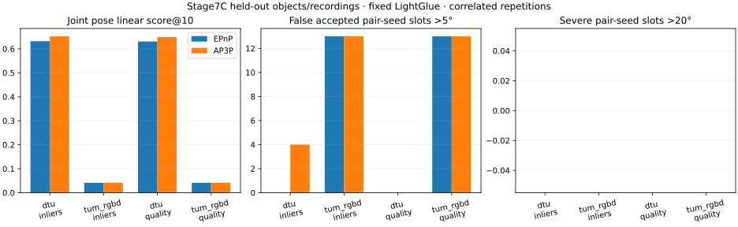

# Stage 7C：AP3P对象/采集序列留出确认

<a id="stage7c-acceptance"></a>
## 阶段验收与保留边界（2026-10-18）

**工程与证据完整性验收通过；跨留出场景稳定性能确认未通过，维持`NO_GO_CONFIRMATION`。** 本次只读复核已有配置、汇总、480组配对变化、补充审计和发布回执，更新本报告；没有运行新匹配、推理、几何求解、评价实验或测试。原实现与结果已随`e220c39`发布，本次验收文档不提交或推送，不合并main、不进入下一阶段。

| 验收项 | 结论与证据边界 |
|---|---|
| 固定范围与公平对照 | 6个新对象/序列、24输入条件、960/960地图运行；B/C、两排序、EPnP/AP3P、五种子完整，不改阈值或替换失败输入 |
| 工程与资源 | 现有审计核对6,240个位姿槽、480组共同种子、42台参考相机与冻结哈希；无进程错误/OOM；整卡采样峰值1,691MiB，低于12GiB |
| 主前端C、质量排序、DTU | 分数@10提高1.887个百分点，完整准确28/60→30/60，错误/严重均0；通过本轮DTU整体门，但scan13/15分数略降 |
| 主前端C、内点排序、DTU | 分数提高2.043个百分点、准确图同样净增2次，但错误0→4，未通过错误不增加门 |
| TUM复制收益 | 两排序均无指标增益，无一次后续PnP成功注册；不能确认复制，也不能据此证明AP3P本身无效 |
| 全局默认升级 | **不通过**；本阶段结束，不继续追加搜索来改变冻结结论 |

### 代表性收益与失败

| 既有案例 | 观察与解释 |
|---|---|
| scan12_spaced3，C/质量，seed43/46 | EPnP两相机部分图→AP3P准确三视图；五种子完整准确3/5→5/5。净增2次属于同一物体/条件，不能算两个独立场景 |
| scan13_blur5，C/内点，seed43–46 | 新增4个>5°错误，约5.55°/7.54°/7.00°/7.97°；没有新增严重错误仍不满足安全门 |
| scan13_blur5，C/内点，seed42 | 注册4→3、分数.542389→.238140；更高整体均值掩盖明显单条件回退 |
| scan13/15，C/质量 | 对象宏平均分数分别下降.001083/.000289；质量排序整体通过不代表逐对象无害 |
| TUM，C，两排序 | 每排序每求解器60图中30图无种子；70次PnP尝试有61次不足12条唯一2D–3D链接，其余9次也未注册。保留无种子、支持不足和几何门拒绝，不能只报告可解子集 |
| DTU，B前端 | 内点/质量排序严重27→17、10→8，但分数各下降.703/.630个百分点，平均注册数略降；尾部改善与平均质量代价同时存在 |

上述错误接受是已注册相机配对的真值角度错误计数，完整准确是地图级指标；相关种子、配对和条件不是独立样本。BA预算限制接受257次、收敛接受19次，其余拒绝/不可运行684次均保留，不能把960次执行写成960次重建成功或BA收敛。完整配对与指标仍见下文原CSV，原始失败与日志保持原位。

### AP3P与两种排序的使用边界

- **AP3P仅作显式可选的PnP候选**：保留既有`ap3p_pnp`与受控runner，不修改旧教学入口或EPnP默认，不自动失败回退、不叠加LM，不用GT或数据集标签择优。已有支持是有限DTU质量排序的局部恢复与历史TUM探索性收益；后者未在本轮复制，不能宣传跨数据集稳定提升。
- **内点排序`inliers`保留为简单研究对照**：其均值收益伴随新增错误，不能作为已验证安全排序，也不能仅因均值较高淘汰质量排序。
- **几何质量排序`quality`保留为显式候选**：在本轮C/DTU控制新增错误方面更好，但对象分数仍有退化，历史跨来源结果也不一致；不能据本轮结果升级为统一优胜默认。
- 两排序仍分别报告；AP3P只替换后续PnP最小求解器，MSAC种子估计、匹配、三角化和BA保持原协议。没有增加部署开关、自动调度或新的单方法命令。所有历史负结果继续有效。

### 是否值得继续优化

**不建议继续围绕AP3P/EPnP、排序组合及阈值进行无边界搜索。** Stage7B的探索性收益经过本轮预冻结确认后仍未满足稳定目标；局部恢复值得保留为项目证据，尚不足以支持继续投入大量试错或宣称原创算法。

若以后另获授权，值得优先考虑的是针对有效几何支持不足的有限诊断，而不是继续更换PnP求解器：先区分未建立可靠种子、已有匹配未形成足够2D–3D轨迹，以及满足支持后仍被几何门拒绝。现有日志只证明这些瓶颈存在，尚未证明具体可修复原因，也不保证修复能提高正确率。本轮不开展该诊断或后续开发。

后续投入的前提应是明确可干预原因与足够的有效求解机会，并以独立对象/序列上的完整准确重建、失败分母、错误尾部和成本共同验收。若收益仍只来自一个物体/条件、只有拟合残差改善、以新增错误换覆盖，或缺少可检验机会，就应停止该候选而非改门限、换帧或追加搜索。本轮留出集已用于验收，不再充当新的独立确认集。

累计贡献是统一相机/失败协议、基线适配、教学SfM/BA、可插拔前后端与受控评价，以及能否定过强收益主张的证据链。本阶段补充了冻结留出确认、局部准确恢复及失败定位；AP3P、MSAC、LightGlue和数值求解器归属第三方。**原创求解器、跨数据集稳定性能优势、稳定融合收益与稠密点云真值精度提升仍未成立。**

## 冻结范围

用户在Stage7B验收后授权进入AP3P独立验证。新阶段只确认已有AP3P候选，不开发新算法，不叠加LM、不改MSAC/PnP/三角化/BA门限，不按数据集或GT自动选择排序。旧教学默认、两种排序、Stage7B全部负结果及尚未提交的验收文档保持原样。独立工作分支为`codex/stage7c-ap3p-confirmation`；不自动提交/推送或合并main。

[唯一冻结配置](../configs/experiments/stage7c_ap3p_confirmation_v1.json)在新数据读取之前完成，SHA256：`d7003d86b0b0c31dc6152bc01dffc143f3cffc91d7b58fc11040bdcdc55409a0`。固定代码基线`d1e986e`；重用[Stage7B运行器](../scripts/run_stage7b_final_search.py)，旧算法及其源码哈希不变。

- 对象/序列：DTU scan12/13/15；TUM fr1_desk2/fr1_room/fr1_teddy；与先前参与选择的对象/序列ID无交集。
- **独立性限定**：新DTU物体仍共享相机轨迹；新TUM采集序列可能与旧desk共享办公室，desk2尤其相关。这是未参与候选选择的对象/序列留出，不是跨地点独立盲测或统计显著性证明。
- 四条件：normal5/reduced3/spaced3/blur5。DTU沿用1–5/10/20图及cal18；TUM沿用官方TAR前8MiB中首先出现的7张RGB，排序后取固定索引，不能按GT、清晰度或重叠替换帧。`normal5`不保证时间相邻。
- B/C前端、内点/质量两排序、原EPnP/AP3P两求解器、种子42–46；共6场景×4条件×2前端×2排序×2求解器×5种子=960次计划地图运行。C为主结果，B只作单列的前端依赖诊断，不能替代C结论。
- 预处理、已知/固定K、特征/匹配、MSAC1.5、PnP1000次/.999/2px/最少12内点、DLT门与BA20次函数评估/5秒均沿用Stage7B。唯一PnP差异是RANSAC最小求解器；缺失真值标unknown、未执行槽位独立列出，不能记为通过。
- 数据来源与读取方式沿用Stage7B：[DTU官方](https://roboimagedata.compute.dtu.dk/?page_id=36)的Rectified.zip只做字节范围读取，拒绝整包回退；[TUM官方](https://cvg.cit.tum.de/data/datasets/rgbd-dataset/download)只读取预声明压缩前缀及小型GT文本。只用RGB，不使用深度。新[数据准备入口](../scripts/prepare_stage7c_confirmation.py)显式接收数据缓存、源码、权重、标定、历史清单和新输出路径；不下载权重。

## 事先确定的判断与停止条件

两种排序分别比较，不在测试后挑一条当作唯一成功结果。主前端C的DTU与TUM均要求分数@10不降、完整准确率不降、错误/严重计数不增、任何场景严重计数不增，且技术检查和计划分母完整。**不设事后非劣容差**，不为抵消Stage7B的DTU退化挑边界。

TUM复制收益额外要求：分数提高至少1个百分点，或在分数不降时错误接受至少减少10%；三个序列的分数均不降；至少4/5种子的序列宏平均差为正。两排序都过才称“TUM留出序列有限复制”；任一排序失败即保留其负结果。若仅TUM通过而DTU不通过，只能报告条件性复制，不升级全局默认。B若新增严重错误，不支持跨前端安全性。

[验收逻辑](../src/georecon/evaluation/confirmation.py)在新输入前以5个CPU测试检查：缺失证据、均值掩盖场景伤害、严重错误增加、种子不稳定、微小增幅和容差偷换均不能通过。[报告器](../scripts/report_stage7c_confirmation.py)只在预测结束后读取真值，核查来源/输入哈希、GT隔离、两PnP臂的种子一致性并重新核对位姿误差；没有从GT反馈到推理的接口。

GPU上限12GiB；新数据传输上限128MiB；新增产物3GiB；RSS8GiB；单会话7200秒。几何阶段4个独立CPU进程，每进程OpenCV线程上限8、BLAS/OMP1，潜在线程总上限32；不宣称与旧串行相同总CPU资源或算法提速。只做一次固定矩阵，访问失败/输入不足不替换场景、不扩大范围；只要分母或参考缺失，就不能宣布完整确认。

以下为本次唯一固定矩阵的实测结果。保持一份阶段报告，原始数据、预测、日志与显存曲线留在Git之外。

## 实际结果与判断

**冻结判定为`NO_GO_CONFIRMATION`；技术检查完整，性能确认门未通过。** 960/960次已执行、未执行槽位0、参考位姿缺失0、进程错误/OOM/BA超时0；不是因为技术缺失而判NO_GO。保留两种排序和AP3P可选候选，但不升级默认、不把下面的局部收益包装成普遍无伤害。

主前端C（共享RootSIFT＋LightGlue），每格为3对象/序列×4条件×5种子=60次相关运行：

| 留出数据 / 排序 | 线性位姿分数@10：EPnP→AP3P | 完整准确图 | 错误接受 | 严重错误 |
|---|---|---|---|---|
| DTU / 内点 | .631675→.652104（+2.043个百分点） | 28/60→30/60 | **0→4** | 0→0 |
| DTU / 质量 | .630324→.649191（+1.887个百分点） | **28/60→30/60** | **0→0** | **0→0** |
| TUM / 内点 | .041415→.041415 | 0/60→0/60 | 13→13 | 0→0 |
| TUM / 质量 | .041415→.041415 | 0/60→0/60 | 13→13 | 0→0 |

指标沿用Stage7B：联合角度误差取旋转角/有方向平移角的最大值；正确≤5°、严重>20°；所有计划配对进入分数分母，未注册得0分。分数是线性截断分数，不是标准CDF-AUC、点云精度或真实3D匹配精度。两种排序预先分别报告，不能事后删去内点排序只发布质量排序。

**有效收益的范围很具体：** DTU质量排序通过预声明的DTU整体非退化/错误门。scan12_spaced3中，seed43/46从两相机部分图恢复到准确三视图，五种子完整准确由3/5→5/5；所有五种子在该条件下分数均提高。全DTU准确图净增2次，但这两次属于**同一物体、同一条件的两个随机种子**，不是恢复两个独立场景。质量排序的对象分数差为scan12 +.057973、scan13 −.001083、scan15 −.000289；存在单物体小幅退化，不可表述成三个物体都稳定改善。五种子宏平均4正1负，收益集中于scan12。

**内点排序的代价也明确：** 四个新增>5°错误都在scan13_blur5、seed43–46，角度约5.55°、7.54°、7.00°、7.97°；没有新增>20°严重错误，仍未通过错误不增加门。seed42在同一条件注册4→3、分数.542389→.238140，保留该明显回退。更多注册/更高均值不能自动判为安全改进。

### TUM为何没有复制收益

每种排序/求解器各60图中，只有30图建立种子，其余30图无初始化；所有已建立的图都停留两相机，**没有一次后续PnP成功注册**。每种排序下两个求解器各有70次PnP尝试，61次因唯一2D–3D链接少于12直接拒绝；只有9次达到最少候选数，最多13条链接。EPnP这9次都RANSAC失败；AP3P有3次RANSAC失败、6次未通过正深度/重投影内点门，也都未注册。因此最终地图和指标相同，五种子宏平均增量都为0。

这说明当前TUM输入主要卡在种子/有效2D–3D支持，**对“成功进入PnP的位姿质量改善”缺少有效检验机会**。不能用零差异证明AP3P数学上无效，也不能借此排除TUM来宣布确认通过。固定TAR成员抽样不保证时间邻近或视场重叠；本轮没有证明具体根因是低重叠、模糊、遮挡还是某个匹配环节，不根据结果换帧、补数据或扩展算法。

次要B前端也有收益/代价：DTU内点排序严重27→17、质量排序10→8，但相应分数.393762→.386731、.424906→.418609，完整准确率均不变，平均注册数略降；TUM无改善。它支持“严重尾部可能减少但平均位姿/覆盖退化”的限定结论，不可替代C的主确认结果。



[16行全组合汇总](results/stage7c_confirmation.csv) · [8行配对对照](results/stage7c_confirmation_contrasts.csv) · [全部480组EPnP/AP3P差异，含不变与失败](results/stage7c_confirmation_pairs.csv)。原始失败、BA候选、GT隔离及补充PnP暴露统计留在`outputs/stage7c_confirmation_v1/`；原图/GT/来源范围在`outputs/stage7c_data_v1/`，不随Git上传。

## 检查、成本与复现

冻结配置/算法/新准备与报告源码哈希核对通过；数据对象/序列与旧选择清单无交集，地理相关性仍按前述限定。报告重新核对6,240个计划位姿槽、480组共同种子和BA前种子位姿一致性；补充只读核对全部行的分数、错误/严重计数和完整准确定义，并从官方投影/GT文本重解析42台参考相机。全部预算未收敛/拒绝状态保留：BA预算限制接受257次、收敛接受19次、少于三相机364次、无种子300次、结构预算拒绝20次；没有把未收敛或跳过写成BA成功收敛。

数据准备137.58s，含新图片/GT读取、特征、模型载入、匹配与落盘；匹配算子合计2.68s，不是端到端计时。正式数据传输77,963,881字节，未整包下载、未下载模型。4进程几何矩阵42.36s，未包含数据准备/测试/报告；最高单进程RSS约104MiB、各进程峰值RSS之和约376MiB。显存100ms整卡采样峰值1,691MiB，包含桌面；Torch峰值分配约327MiB、保留854MiB，低于12GiB，几何阶段GPU为0。不同调度和样本下的秒数不能用来证明相对Stage7B算法加速。

发布前干净代码副本的CPU测试245项：**244通过，1项原生PyCOLMAP因主环境无该依赖跳过**；专用COLMAP环境适配器10项全部通过，覆盖该原生项。新增5项确认门测试包含缺失证据、场景伤害、种子不稳定和“微小均值不能自动通过”等约束。Stage7C提交`e220c39`的[GitHub CPU CI](https://github.com/zchming/GeoRecon-Fusion-Geometry-Reliability-Aware-Hybrid-Multi-View-3D-Reconstruction/actions/runs/39097008850)成功：245项报告，239通过、6项需要独立LightGlue环境而跳过，失败/错误均0。以上是已完成的发布检查，本次文档验收未重跑；跳过不算通过，CPU CI不证明完整GPU实验或数据读取可在线复现。

复现需要Stage7A匹配配置缓存、Stage7B冻结几何配置缓存、已有官方cal18投影矩阵，以及固定LightGlue源码/权重与原实验环境；不声称纯Git克隆可离线还原真实数据结果。`LIGHTGLUE_SOURCE`、`LIGHTGLUE_WEIGHTS`需显式设为已核对的本地路径，所有新输出必须不存在。按配置仍需网络进行限额数据读取，不要执行到已有结果目录。

```bash
PYTHONPATH=src OPENBLAS_NUM_THREADS=1 OMP_NUM_THREADS=1 python scripts/prepare_stage7c_confirmation.py \
  --output outputs/stage7c_data_new --config configs/experiments/stage7c_ap3p_confirmation_v1.json \
  --source "$LIGHTGLUE_SOURCE" --weights "$LIGHTGLUE_WEIGHTS" \
  --cache outputs/stage7a_v1_after_guard_fix --baseline outputs/stage7b_initialization_v2 \
  --calibration data/stage3_dtu/scan1_pool/calibration \
  --previous outputs/stage7b_initialization_v2 --previous outputs/stage7b_cross_dataset_v1 \
  --previous outputs/stage7b_final_data_v1
PYTHONPATH=src OPENBLAS_NUM_THREADS=1 OMP_NUM_THREADS=1 python scripts/run_stage7b_final_search.py predict \
  --output outputs/stage7c_prediction_new --config configs/experiments/stage7c_ap3p_confirmation_v1.json \
  --bundle outputs/stage7c_data_new --selection configs/experiments/stage7c_ap3p_confirmation_v1.json --workers 4
PYTHONPATH=src python scripts/run_stage7b_final_search.py evaluate \
  --output outputs/stage7c_prediction_new --config configs/experiments/stage7c_ap3p_confirmation_v1.json
PYTHONPATH=src python scripts/report_stage7c_confirmation.py \
  --study outputs/stage7c_prediction_new --data outputs/stage7c_data_new \
  --config configs/experiments/stage7c_ap3p_confirmation_v1.json --output outputs/stage7c_review_new
```

`--selection`在此传入本阶段预声明AP3P锁定配置，不重新调用Stage7B开发集选择器；两种排序都运行，不会按新真值决定方法。

## 贡献、局限与停止

累计已有统一重建/评价协议、基线适配、教学SfM/BA与受控前端/后端对照。本轮新增的是不改旧算法的留出确认工程、事前固定的可测试验收逻辑、准确三视图恢复实例及新增错误接受的定位，并明确区分“没有收益”与“候选缺少成功注册暴露”。AP3P、MSAC、LightGlue和数值求解器仍属于第三方，不是本人的新求解器。

新证据支持**质量排序+AP3P在本轮DTU整体上的有边界工程收益**；不支持全部新物体无害、TUM收益已复制、跨场景稳定默认、原创算法或稠密点云精度提升。TUM序列相关性、非邻近档案抽样、少量独立物体、相关种子及历史缓存依赖仍限制外推。先前的负结果不被本轮局部改善覆盖。

本阶段按一次固定矩阵停止。保留两种排序和AP3P显式可选状态，不自动换默认，不补做新的筛选/匹配/注册算法或额外数据试验，不推进下一阶段。原实现与证据已按授权提交推送；本次新增验收文档修改保持未提交，等待用户审阅。
